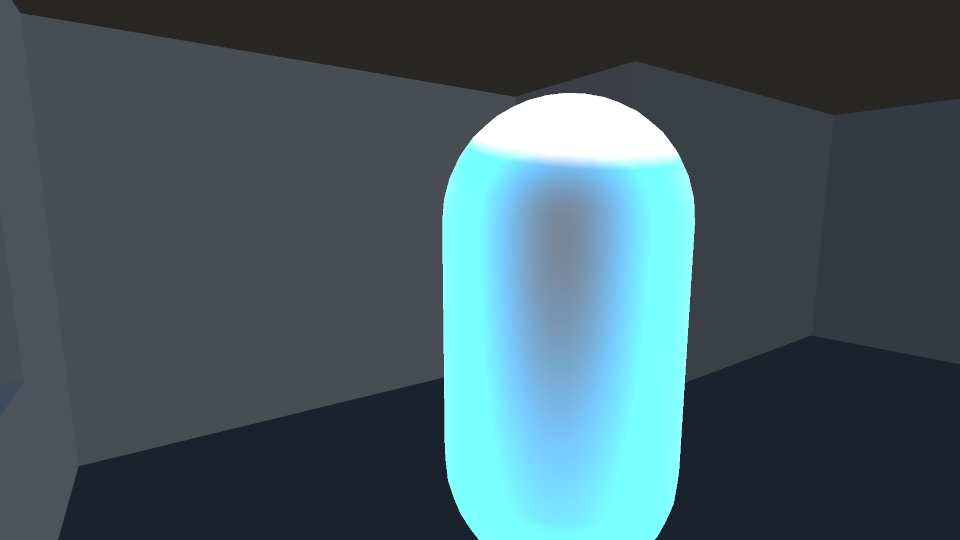
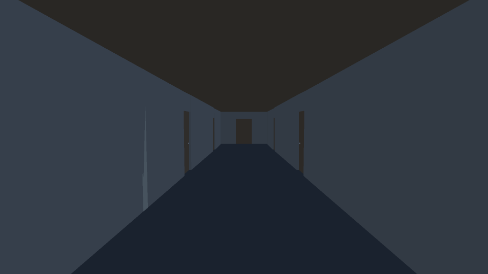
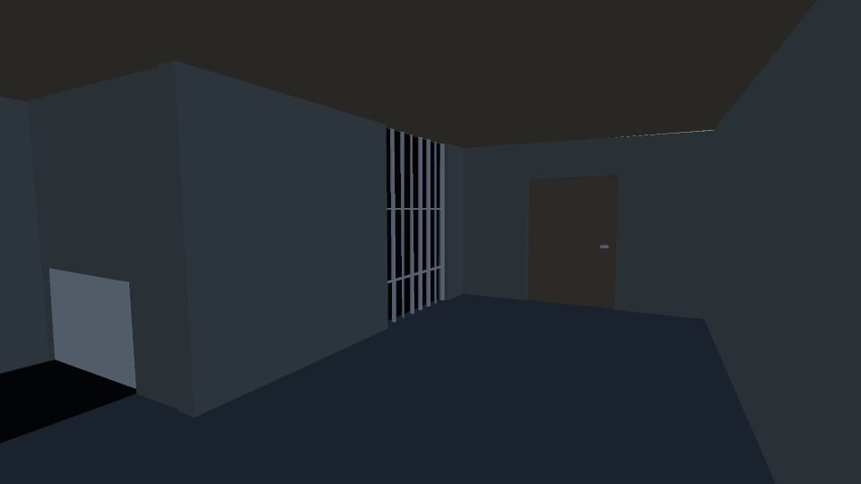

# Halloween Game Jam 2026

First-person horror built for a game jam on **Unity 6**. Gameplay runs on **LeoECS Lite**,
infrastructure on **Zenject** — the project is a working example of where the line between
the two should sit.

  
  
  

## What it is

A short first-person horror: you move through a space, interact with objects, and the game
pushes back with fear and scare zones that react to where you are and what you do.
Dialogue and in-game text run through Typecraft, a reusable package of mine.

The jam deadline is the point: the architecture below had to survive being built fast.

## Architecture

The interesting part of this repo is not the game — it is the boundary.

**Zenject owns infrastructure.** Services, configs, platform access and object lifetime live
in the DI container. Nothing in the container knows that an ECS world exists, except through
one interface.

**LeoECS Lite owns gameplay.** Entities, components and systems hold everything that changes
frame to frame. No gameplay system reaches into a service directly — the world is handed to
them through `IEcsWorldProvider`.

**The frame is assembled in stages.** Input → simulation → presentation → cleanup, composed
in one place instead of being scattered across `Update` calls. When something happens in the
wrong order, there is exactly one file to look at.

**Scene objects become entities through authoring.** Designers place objects in the scene;
authoring MonoBehaviours convert them into entities at startup. The scene stays editable
without the ECS world leaking into it.

## Worth a look in the code

| What | Where |
| --- | --- |
| Frame pipeline, stage by stage | `Assets/Game/Scripts/ECS/EcsStartup.cs` |
| The one seam between DI and ECS | `Assets/Game/Scripts/ECS/IEcsWorldProvider.cs`, `EcsWorldProvider.cs` |
| Scene objects → entities | `Assets/Game/Scripts/ECS/Authoring/` |
| Components, split by feature | `Assets/Game/Scripts/ECS/Components/` |
| Systems | `Assets/Game/Scripts/ECS/Systems/` |
| Zenject installers | `Assets/Game/Scripts/Dependencies/` |
| Services behind interfaces | `Assets/Game/Scripts/Services/` |
| Presentation layer | `Assets/Game/Scripts/Views/`, `Rendering/` |
| How the retro look is built | [`Docs/PSX-Guide.md`](Docs/PSX-Guide.md), [`Docs/Retro-FX.md`](Docs/Retro-FX.md) |
| Tunable values, no magic numbers | `Assets/Game/Scripts/Configs/` |
| Dialogue assets (Typecraft) | `Assets/Game/Dialogues/` |

## How this was built

Development ran through an agentic AI workflow rather than a chat window.
[`CLAUDE.md`](CLAUDE.md) in the repository root is the actual contract the agents work under:
what they may touch, what they must not, and how generated code gets reviewed.

The short version of that contract: generated code goes through the same review as anything
written by hand, and code nobody can defend does not ship.

`codegraph.json` backs a symbol graph used for navigation, and the project is wired to the
Unity Editor over MCP — scenes, prefabs and ScriptableObjects are edited through the editor
itself rather than by patching YAML.

## Stack

Unity 6 · C# · LeoECS Lite · Extenject (Zenject) · URP · Cinemachine 3 · Input System ·
Addressables · Unity Localization · TMPEffects · Typecraft · NuGetForUnity · Unity MCP

## Notes

Jam code, with jam tradeoffs — scope is small and content is thin. The architecture is the
part meant to be read.
